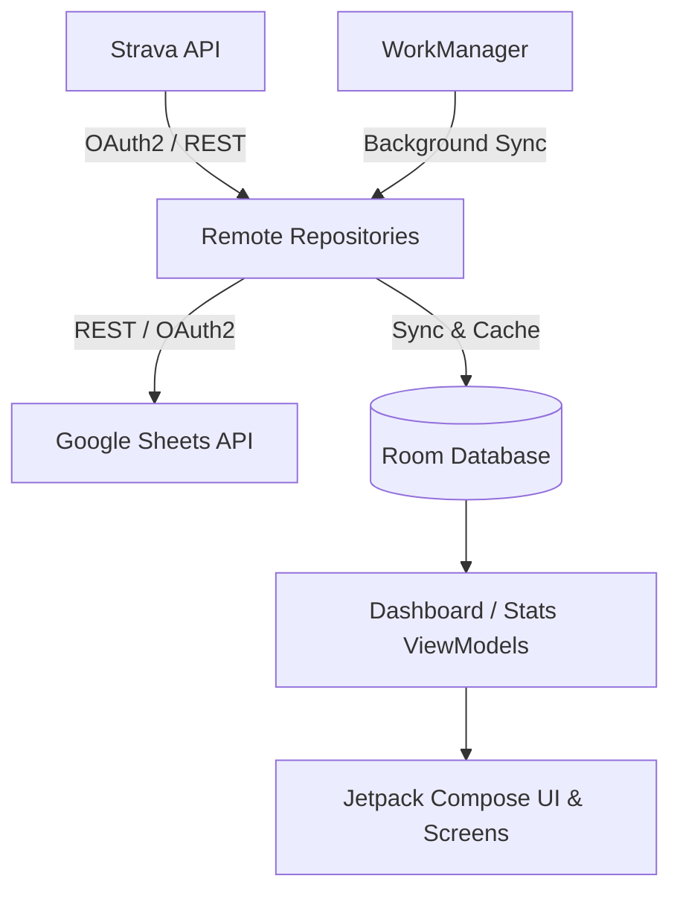

# 🚴 Strv2Shts

[](https://www.android.com)
[](https://kotlinlang.org)
[](https://developer.android.com/jetpack/compose)
[](https://m3.material.io/)
[](https://opensource.org/licenses/MIT)

**Strv2Shts** (Strava to Sheets) ist eine moderne, native Android-App zur vollautomatischen Synchronisation von Strava-Aktivitäten in eine personalisierte Google Sheets Tabelle. Ergänzend dazu bietet die App umfangreiche Auswertungen zu Trainingsdaten, Zielverfolgung, Herzfrequenz-/Watt-Zonen und ein vollständiges Performance Management Chart basierend auf dem **Banister-Modell (Fitness, Ermüdung & Form)**.

---

## 🌟 Hauptfunktionen

### 1. 🔄 Nahtlose Synchronisation (Strava ➡️ Google Sheets)
- **Strava OAuth2 Integration:** Sichere Anmeldung und automatischer Token-Refresh via EncryptedSharedPreferences.
- **Google Sheets API v4:** Direkter Export der Aktivitäten als tabellarische Zeilen in konfigurierte Google Spreadsheets.
- **Hintergrund-Synchronisation:** Zuverlässige Synchronisation im Hintergrund mithilfe von `WorkManager`.
- **Statusverwaltung:** Granulare Nachverfolgung pro Aktivität (`PENDING`, `SYNCED`, `FAILED`, `AUTH_REQUIRED`).

### 2. 📊 Aktivitäten & Zonen-Analyse
- **Detaillierte Übersicht:** Liste aller Aktivitäten mit Filterung (Status), Volltextsuche und Sortierung.
- **Minimierbare Filterleiste:** Klappbarer Filterbereich für maximale Übersichtlichkeit.
- **Zonen-Verteilung (HF & Watt):** Aufklappbarer Analysebereich pro Aktivität:
  - **Herzfrequenz-Zonen (Z1–Z5):** Erholung, Ausdauer, Tempo, Schwelle, Anaerob mit Zeitdauer und prozentualem Anteil.
  - **Watt-Zonen (Z1–Z7):** Coggan-Leistungszonen von Aktiver Erholung bis Neuromuskulär.
- **Umfassende Metriken:** Distanz, Höhenmeter, Durchschnitts-/Maximalgeschwindigkeit, Trittfrequenz, Suffer Score, Kalorien uvm.

### 3. 📈 Leistungsanalyse & Banister-Modell (Fitness & Form)
- **Performance Management Chart (PMC):**
  - **Fitness (CTL - Chronic Training Load):** 42-Tage-Gleitender Durchschnitt der Trainingsbelastung.
  - **Ermüdung (ATL - Acute Training Load):** 7-Tage-Gleitender Durchschnitt der Ermüdung.
  - **Form (TSB - Training Stress Balance):** Differenz ($CTL - ATL$) zur Erkennung von Peak-Form oder Übertraining.
- **Interaktiver Zeitverlauf:** Dynamische Canvas-Verlaufsgrafik mit wählbaren Zeitfenstern (*Letzter Monat, Letzte 2/6 Monate, Letztes Jahr, Letzte 2 Jahre, Gesamtzeitraum*).
- **Historischer Verlauf:** Gewicht & FTP-Historie mit Trend-Chart und tabellarischer Historie (neueste Einträge oben).

### 4. 🎯 Ziele & Statistiken
- **Zielverfolgung (Goals):** Definition und Überwachung von Wochen-, Monats- und Jahreszielen (Distanz, Zeit oder Höhenmeter) mit Fortschrittsbalken.
- **Periodische Statistiken:** Aggregierte Kennzahlen nach Zeitraum und Sportart.
- **Dokumentation:** Integrierte Info- und Dokumentationsübersicht direkt in der App.

---

## 📱 Screenshots & UI

Die App setzt vollständig auf **Jetpack Compose** und **Material 3**:
- Konsistenter `AppBackground` mit dezentem Farbverlauf und Blur-Effekt.
- Responsive Bottom-Navigation (aktiver Tab mit Icon & Text, inaktive Tabs kompakt nur mit Icon).
- Horizontale und vertikale Scrollcontainer, optimiert gegen Textumbrüche auf verschiedensten Displaygrößen.

---

## 🏗️ Architektur & Technologien

Die App folgt den offiziellen Android-Architekturrichtlinien (Clean Architecture & MVVM):



- **Programmiersprache:** Kotlin (JVM 17)
- **UI Toolkit:** Jetpack Compose mit Material 3
- **Lokale Datenbank:** Android Room (SQLite) mit KSP
- **Netzwerk:** Retrofit 2, OkHttp3 Logging Interceptor, Kotlinx Serialization
- **Hintergrundverarbeitung:** AndroidX WorkManager (Coroutines Worker)
- **Sicherheit:** AndroidX Security Crypto (`EncryptedSharedPreferences`) für Tokens und API-Schlüssel
- **Grafik & Visualisierung:** Custom Canvas-Zeichenroutinen für performante Zeitreihencharts

---

## 🚀 Setup & Erste Schritte

### Voraussetzungen
- Android Studio Ladybug (oder neuer)
- Android SDK 35 (Minimum SDK 26 / Android 8.0 Oreo)
- Java 17 JDK
- Strava API Application ([Strava Developers](https://developers.strava.com/))
- Google Cloud Console Projekt mit aktivierter Google Sheets API

### Installation

1. **Repository klonen:**
   ```bash
   git clone https://github.com/DEIN-BENUTZERNAME/Strv2Shts.git
   cd Strv2Shts
   ```

2. **In Android Studio öffnen:**
   - Öffne Android Studio und wähle `Open`, navigiere zum Projektordner.
   - Warte, bis der Gradle Sync abgeschlossen ist.

3. **API-Schlüssel konfigurieren:**
   - Trage deine Strava `Client ID` und das `Client Secret` in der App unter **Google Konfiguration** / Einstellungen ein oder hinterlege diese in den entsprechenden Konfigurationsdateien.
   - Konfiguriere die Google OAuth 2.0 Web Client ID für die Google Drive / Sheets Anbindung.

4. **Kompilieren und Ausführen:**
   - Verbinde ein Android-Gerät oder starte einen Emulator (API 26+) und drücke **Run (Shift + F10)**.

---

## 📂 Projektstruktur

```
app/src/main/java/com/example/strava2sheets/
├── MainActivity.kt               # Single-Activity Einstiegspunkt
├── core/
│   └── util/                     # Hilfsklassen (DataFormatter, Berechnungen)
├── data/
│   ├── local/                    # Room DB (Entities, DAOs, TypeConverter)
│   ├── remote/                   # Retrofit APIs, Auth Manager (Strava & Google), DTOs
│   ├── repository/               # Activity- & Athleten-Repository
│   ├── security/                 # Verschlüsselter TokenStorage
│   └── worker/                   # WorkManager (StravaFetchWorker, SheetsUploadWorker)
└── ui/
    ├── activities/               # Aktivitätsliste & Zonen-Detailkarten
    ├── athlete/                  # Athletenprofil, Gewicht/Watt-Historie & Banister-PMC
    ├── common/                   # Gemeinsame Komponenten (AppBackground, etc.)
    ├── dashboard/                # Startseite mit Sync-Status & Google Konfiguration
    ├── document/                 # Infoseite & Dokumentation
    ├── fitness/                  # FitnessEngine (CTL, ATL, TSB Berechnungen)
    ├── goals/                    # Trainingsziele (Goals) & Fortschritt
    ├── navigation/               # Compose Navigation Graph & Bottom Bar
    ├── splash/                   # Animierter Ladebildschirm
    └── stats/                    # Statistiken & Filter-Engine
```

---

## 🔒 Datenschutz & Sicherheit

- **Lokale Speicherung:** Alle Aktivitätsdaten, Zugangs-Tokens und Benutzerwerte verbleiben auf dem lokalen Gerät in einer geschützten Room-Datenbank.
- **Verschlüsselung:** Sensible OAuth-Token (Strava & Google) werden ausschließlich verschlüsselt im Android Keystore abgelegt.
- **Keine Tracking-Server:** Es gibt keine zwischengeschalteten Third-Party Server; die Kommunikation erfolgt direkt zwischen deinem Smartphone, Strava und Google.

---

## 📄 Lizenz

Dieses Projekt ist unter der [MIT Lizenz](LICENSE) lizenziert.
