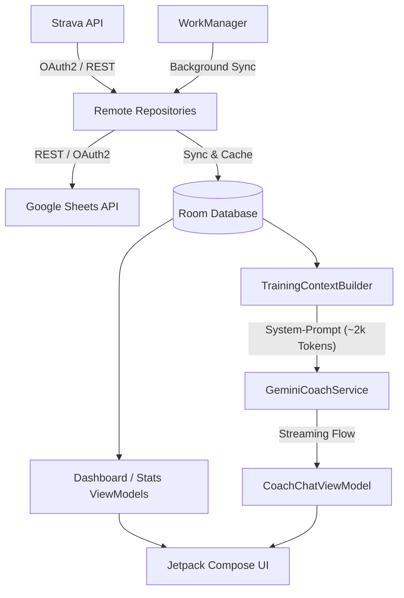

# 🚴 Strv2ShtsAI (AeroCoach)

[](https://www.android.com)
[](https://kotlinlang.org)
[](https://developer.android.com/jetpack/compose)
[](https://m3.material.io/)
[](https://aistudio.google.com/)
[](https://opensource.org/licenses/MIT)

**Strv2ShtsAI** (Strava to Sheets AI) ist eine moderne, native Android-App, die das nahtlose Logging von Strava-Aktivitäten in Google Sheets mit einem intelligenten, persönlichen KI-Ausdauertrainer (**AeroCoach**) auf Basis des **Google GenAI Android SDK** verbindet.

Zusätzlich bietet die App fundierte Trainingslehre-Tools wie das **Banister/Coggan Performance Management Chart (CTL, ATL, TSB)**, **ACWR-Überlastungswarnungen**, **80/20-Intensitätsanalysen** und umfangreiche Zonen-Auswertungen (Herzfrequenz & Watt).

---

## 🌟 Hauptfunktionen

### 1. 🧠 AeroCoach AI (Persönlicher Gemini-Trainer)
- **Google GenAI Android SDK Integration:** Nutzt Google AI Studio Modelle mit kontinuierlichem Token-Streaming (`Flow<String>`).
- **Leichtgewichtige Modell-Fallback-Kette:** Priorisiert automatisch die ressourcensparendsten und schnellsten Modelle:
  1. `gemini-3.5-flash-lite` (Standard/Ultra-Low Latency)
  2. `gemini-3.5-flash`
  3. `gemini-3.8-flash`
  4. `gemini-2.5-flash`
- **Umfassender Datenkontext (~2.000 Tokens System-Prompt):**
  - **Athletenprofil:** Gewicht, FTP ($W$ & $W/kg$), HF- und Watt-Zonen.
  - **Form & Belastung (PMC):** Aktuelle CTL (Fitness), ATL (Ermüdung), TSB (Form) und ACWR (Acute:Chronic Workload Ratio zur Verletzungsprävention).
  - **365-Tage-Zusammenfassung:** Jahreskilometer, Höhenmeter, Aktivtage vs. Ruhetage, Ruhetags-Quote (%) und Sportarten-Split.
  - **Trends:** 4-Wochen-Kilometer-Entwicklung, aktueller Monat vs. Vormonat, 80/20-Intensitätsverteilung (polarisiertes Training).
  - **Historie:** Die letzten 12 Einheiten detailliert aufbereitet (Datum, Sportart, Distanz, Zeit, avg/max HF, Watt, Suffer Score).
  - **Zukunftssichere Biometrie-Felder:** Vorbereitet für Ruhepuls (RHR + 7-Tage-Schnitt), HRV (rMSSD), Schlafstunden und Muskelkater/RPE (1–5).
- **Interaktives Chat-UI:**
  - Streaming-Bubbles mit Echtzeitanzeige des Texts.
  - Nach unten verankertes Chatfenster mit dynamischer Expansion nach oben.
  - Quick-Prompt-Chips (*"Wie ist meine aktuelle Form?"*, *"Kann ich heute intensiv trainieren?"*, *"Analysiere meine letzten 2 Wochen"*, etc.).
  - Sichere Schlüsselspeicherung (EncryptedSharedPreferences) und Modellstatusanzeige in der Kopfzeile.

### 2. 🔄 Nahtlose Synchronisation (Strava ➡️ Google Sheets)
- **Strava OAuth2 Integration:** Sichere Anmeldung und automatischer Token-Refresh via EncryptedSharedPreferences.
- **Google Sheets API v4:** Direkter Export der Aktivitäten als tabellarische Zeilen in konfigurierte Google Spreadsheets.
- **Hintergrund-Synchronisation:** Zuverlässige Synchronisation im Hintergrund mithilfe von `WorkManager`.
- **Statusverwaltung:** Granulare Nachverfolgung pro Aktivität (`PENDING`, `SYNCED`, `FAILED`, `AUTH_REQUIRED`).

### 3. 📊 Aktivitäten & Zonen-Analyse
- **Detaillierte Übersicht:** Liste aller Aktivitäten mit Filterung (Status), Volltextsuche und Sortierung.
- **Minimierbare Filterleiste:** Klappbarer Filterbereich für maximale Übersichtlichkeit.
- **Zonen-Verteilung (HF & Watt):** Aufklappbarer Analysebereich pro Aktivität:
  - **Herzfrequenz-Zonen (Z1–Z5):** Erholung, Ausdauer, Tempo, Schwelle, Anaerob mit Zeitdauer und prozentualem Anteil.
  - **Watt-Zonen (Z1–Z7):** Coggan-Leistungszonen von Aktiver Erholung bis Neuromuskulär.
- **Umfassende Metriken:** Distanz, Höhenmeter, Durchschnitts-/Maximalgeschwindigkeit, Trittfrequenz, Suffer Score, Kalorien uvm.

### 4. 📈 Leistungsanalyse & Banister-Modell (Fitness & Form)
- **Performance Management Chart (PMC):**
  - **Fitness (CTL - Chronic Training Load):** 42-Tage-Gleitender Durchschnitt der Trainingsbelastung.
  - **Ermüdung (ATL - Acute Training Load):** 7-Tage-Gleitender Durchschnitt der Ermüdung.
  - **Form (TSB - Training Stress Balance):** Differenz ($CTL - ATL$) zur Erkennung von Peak-Form oder Übertraining.
- **Interaktiver Zeitverlauf:** Dynamische Canvas-Verlaufsgrafik mit wählbaren Zeitfenstern (*Letzter Monat, Letzte 2/6 Monate, Letztes Jahr, Letzte 2 Jahre, Gesamtzeitraum*).
- **Historischer Verlauf:** Gewicht & FTP-Historie mit Trend-Chart und tabellarischer Historie.

### 5. 🎯 Ziele & Statistiken
- **Zielverfolgung (Goals):** Definition und Überwachung von Wochen-, Monats- und Jahreszielen (Distanz, Zeit oder Höhenmeter) mit Fortschrittsbalken.
- **Periodische Statistiken:** Aggregierte Kennzahlen nach Zeitraum und Sportart.
- **Dokumentation:** Integrierte Info- und Dokumentationsübersicht direkt in der App.

---

## 📱 Navigation & UI

Die App setzt vollständig auf **Jetpack Compose** und **Material 3**:
- Konsistenter `AppBackground` mit dezentem Farbverlauf.
- Responsive 7-Tab Bottom-Navigation:
  1. 🏠 **Start** (Dashboard & Google-Konfiguration)
  2. 🧠 **Coach** (AeroCoach AI Chat)
  3. 📋 **Aktivität** (Aktivitätsliste & Zonen)
  4. ⭐ **Statistik** (Periodische Kennzahlen)
  5. 🔔 **Ziele** (Zielverfolgung & Fortschritt)
  6. 👤 **Benutzer** (Athletenprofil, Zonen & PMC-Chart)
  7. ℹ️ **Dokument** (App-Dokumentation)

---

## 🏗️ Architektur & Technologien

Die App folgt den offiziellen Android-Architekturrichtlinien (Clean Architecture & MVVM):



- **Programmiersprache:** Kotlin (JVM 17)
- **UI Toolkit:** Jetpack Compose mit Material 3
- **KI:** Google Generative AI Android SDK (`com.google.ai.client.generativeai`)
- **Lokale Datenbank:** Android Room (SQLite) mit KSP
- **Netzwerk:** Retrofit 2, OkHttp3 Logging Interceptor, Kotlinx Serialization
- **Hintergrundverarbeitung:** AndroidX WorkManager (Coroutines Worker)
- **Sicherheit:** AndroidX Security Crypto (`EncryptedSharedPreferences`) für Tokens und Gemini API-Key
- **Grafik & Visualisierung:** Custom Canvas-Zeichenroutinen für performante Zeitreihencharts

---

## 🚀 Setup & Erste Schritte

### Voraussetzungen
- Android Studio Ladybug (oder neuer)
- Android SDK 35 (Minimum SDK 26 / Android 8.0 Oreo)
- Java 17 JDK
- Strava API Application ([Strava Developers](https://developers.strava.com/))
- Google Cloud Console Projekt mit aktivierter Google Sheets API
- Google AI Studio API-Key ([Google AI Studio](https://aistudio.google.com/))

### Installation

1. **Repository klonen:**
   ```bash
   git clone https://github.com/DEIN-BENUTZERNAME/Strv2ShtsAI.git
   cd Strv2ShtsAI
   ```

2. **In Android Studio öffnen:**
   - Öffne Android Studio und wähle `Open`, navigiere zum Projektordner.
   - Warte, bis der Gradle Sync abgeschlossen ist.

3. **API-Schlüssel konfigurieren:**
   - **Strava:** Trage `Client ID` und `Client Secret` in den Einstellungen ein.
   - **Google Sheets:** Konfiguriere die Google OAuth 2.0 Web Client ID für Drive & Sheets.
   - **Gemini AI:** Kopiere deinen API-Key aus Google AI Studio und speichere ihn in der App im Tab **Coach** über das Schloss-/Schlüssel-Icon.

4. **Kompilieren und Ausführen:**
   - Verbinde ein Android-Gerät oder starte einen Emulator (API 26+) und drücke **Run (Shift + F10)**.

---

## 📂 Projektstruktur

```
app/src/main/java/com/example/strava2sheets/
├── MainActivity.kt               # Single-Activity Einstiegspunkt & ViewModel-Provider
├── ai/                           # 🧠 Gemini AI Coach Modul
│   ├── GeminiCoachService.kt     # Streaming-Service mit Modell-Fallback-Kette
│   └── TrainingContextBuilder.kt # Aggregation von Profil, PMC, Trends & 2k-Token Prompt
├── core/
│   └── util/                     # Hilfsklassen (DataFormatter, Berechnungen)
├── data/
│   ├── local/                    # Room DB (Entities, DAOs, TypeConverter)
│   ├── remote/                   # Retrofit APIs, Auth Manager (Strava & Google), DTOs
│   ├── repository/               # Activity- & Athleten-Repository
│   ├── security/                 # Verschlüsselter TokenStorage (OAuth + Gemini API Key)
│   └── worker/                   # WorkManager (StravaFetchWorker, SheetsUploadWorker)
└── ui/
    ├── activities/               # Aktivitätsliste & Zonen-Detailkarten
    ├── athlete/                  # Athletenprofil, Gewicht/Watt-Historie & Banister-PMC
    ├── coach/                    # 🧠 AeroCoach Chat-UI & ViewModel
    │   ├── CoachChatScreen.kt    # Compose Chat, Streaming Bubbles, Quick-Chips & Dialog
    │   └── CoachChatViewModel.kt # StateFlow & Orchestrierung von Daten & Streaming
    ├── common/                   # Gemeinsame Komponenten (AppBackground, etc.)
    ├── dashboard/                # Startseite mit Sync-Status & Google Konfiguration
    ├── document/                 # Infoseite & Dokumentation
    ├── fitness/                  # FitnessEngine (CTL, ATL, TSB Berechnungen)
    ├── goals/                    # Trainingsziele (Goals) & Fortschritt
    ├── navigation/               # Compose Navigation Graph & 7-Tab Bottom Bar
    ├── splash/                   # Animierter Ladebildschirm
    └── stats/                    # Statistiken & Filter-Engine
```

---

## 🔒 Datenschutz & Sicherheit

- **Lokale Speicherung:** Alle Aktivitätsdaten, Zugangs-Tokens und Benutzerwerte verbleiben auf dem lokalen Gerät in einer geschützten Room-Datenbank.
- **Verschlüsselung:** Sensible OAuth-Tokens (Strava & Google) sowie der Gemini API-Key werden ausschließlich verschlüsselt im Android Keystore (`EncryptedSharedPreferences`) abgelegt.
- **Privatsphäre beim KI-Coaching:** An Gemini werden ausschließlich aggregierte Trainingsmetriken (wie Watt, HF-Zonen, CTL/ATL und letzte Einheiten) übermittelt – keine Passwörter, Tokens oder persönlichen Accountdaten.
- **Keine Tracking-Server:** Keine zwischengeschalteten Third-Party Server; alle Verbindungen laufen direkt vom Smartphone zu Strava, Google Cloud und Google Generative AI.

---

## 📄 Lizenz

Dieses Projekt ist unter der [MIT Lizenz](LICENSE) lizenziert.
